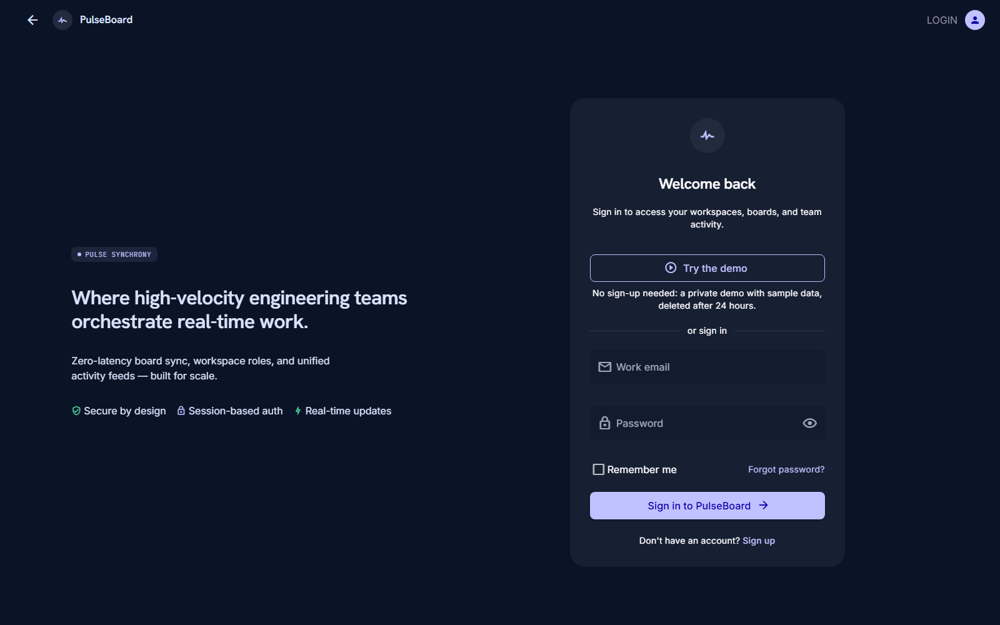
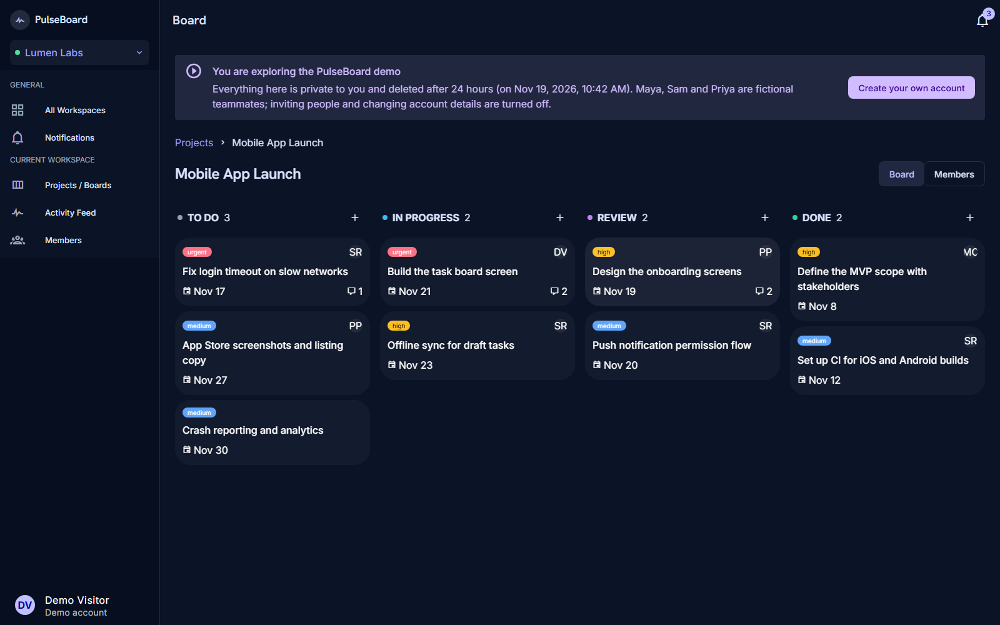
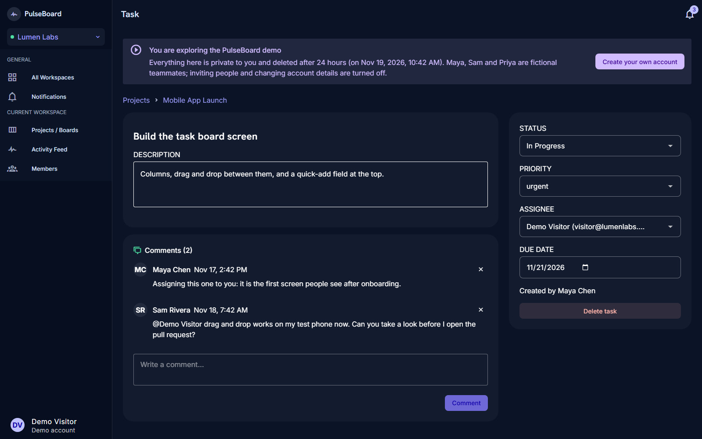
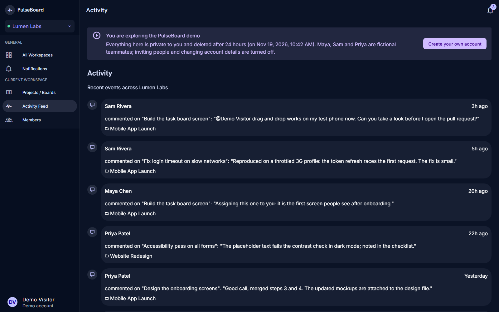
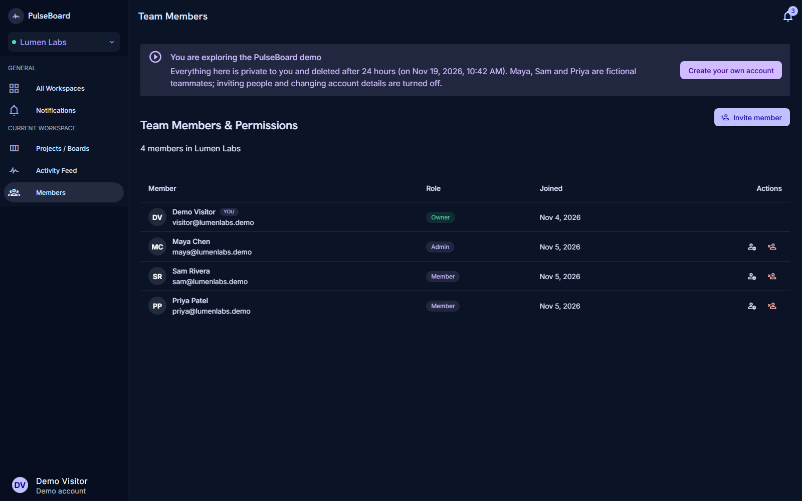

# PulseBoard — Web App

The Vue 3 SPA for [PulseBoard](https://pulseboardapp.org), a real-time project management app for small teams: workspaces, Kanban boards, comments, an activity feed, and live notifications. This repo is the frontend half; the Laravel API it talks to lives in [`pulseboard-backend`](https://github.com/nadimelchammaii-hash/pulseboard-backend).

**Live demo: [pulseboardapp.org](https://pulseboardapp.org)** — click **Try the demo** on the login page and you land on a sample Kanban board in a few seconds. No sign-up required.



## What it does

- **Kanban board** — drag tasks between To Do, In Progress, Review, and Done. Teammates' changes appear without reloading.
- **Task details** — description, status, priority, assignee, due date, and comments with @mentions.
- **Workspaces and roles** — create workspaces, invite people as Owner, Admin, or Member, and choose who belongs to each project.
- **Activity feed** — a live timeline of everything that happened in a workspace.
- **Notifications** — a bell with an unread count for invitations, assignments, and mentions, pushed in real time.



## The live demo

The login page's **Try the demo** button signs you into a brand-new, private demo account (not a shared one, so nothing you do affects anyone else) and opens the sample "Mobile App Launch" board. The demo workspace has three fictional teammates, three projects, tasks in every column, comments, an activity history, and unread notifications:




A banner stays visible for the whole session, showing when the demo will be deleted (after 24 hours) with a **Create your own account** button. Changing account details and inviting people are turned off for demo accounts (enforced by the API, which explains why in a readable message).



## Stack

- **Vue 3** (Composition API) + **Vite**
- **Vuetify 4** — Material component library with a custom dark theme
- **TypeScript**
- **Pinia** for state — one store per domain (`auth`, `workspaces`, `projects`, `tasks`, `activities`, `notifications`)
- **Vue Router**
- **Laravel Echo** + **pusher-js** for real-time updates from Laravel Reverb
- **ESLint** (`eslint-config-vuetify`) + `vue-tsc` for linting/type-checking

## How it works

- **Sanctum SPA auth, not tokens.** A CSRF cookie is fetched once, then the browser's session cookie *is* the auth state. Login, register, and the demo all return the same user shape, so the rest of the app never cares how a session started.
- **One Pinia store per resource**, each owning its API calls and state. Pages call stores; stores call the modules in `src/api/`.
- **Real-time updates land in the same stores.** Echo listens on private channels for the open board, the workspace, and the user's notifications, so a page shows the same data whether it came from a request or from a teammate's change.
- **A themed design system, not Vuetify defaults.** Colors, typography, and component defaults are set centrally in `src/plugins/vuetify.ts`, following a design made in Google Stitch (kept in [`design/stitch/`](design/stitch/)).

## Getting started

To run this app against an already-running [API](https://github.com/nadimelchammaii-hash/pulseboard-backend):

```bash
npm install
cp .env.example .env   # set VITE_API_URL and the VITE_REVERB_* values to match the API
npm run dev            # http://localhost:3000
```

The API must accept that address (`FRONTEND_URL` and `SANCTUM_STATEFUL_DOMAINS` in its `.env`), or sign-in won't stick.

### Scripts

```bash
npm run dev          # Vite dev server
npm run build        # type-check + production build
npm run lint         # ESLint
npm run type-check   # vue-tsc
```

## Deployment

Production builds to static files and serves them with nginx (`Dockerfile.prod`); the API and WebSocket addresses are passed in at build time. Caddy serves this app and the API on one domain, so there's no CORS to configure.
